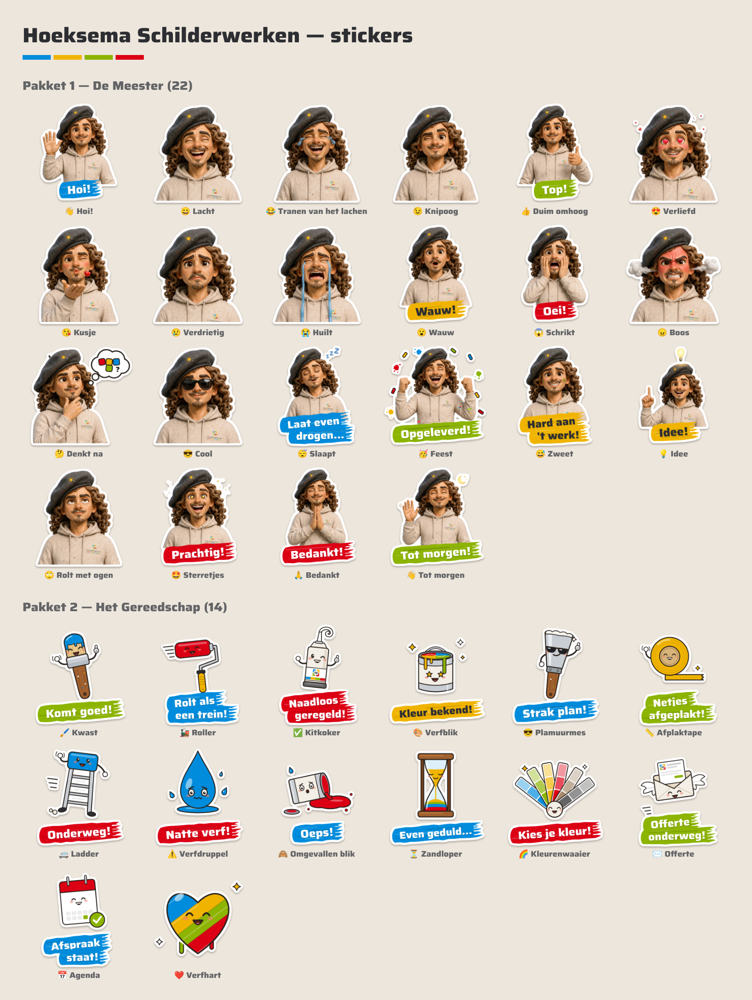

# Hoeksema Schilderwerken: eigen stickers

36 eigen stickers in de huisstijl, verdeeld over twee pakketten:

- **Pakket 1 — De Meester (22):** onze mascotte in 3D, precies zoals de 3D-tekening, in alle emoties.
- **Pakket 2 — Het Gereedschap (14):** lachende kwast, roller, kitkoker, verfblik en meer, elk met een schildersgrap.



## Wat zit erin

| Map | Wat | Waarvoor |
|---|---|---|
| `png/` | 512 × 512 px, transparante achtergrond (3D-Meester + gereedschap) | iPhone-stickers, Telegram, Signal, e-mail, website |
| `png-1024/` | 3D-Meester op 1024 × 1024 px (alleen in het zip-bestand) | Drukwerk van de 3D-stickers |
| `whatsapp/meester/`, `whatsapp/gereedschap/` | 512 × 512 WebP (< 100 KB) + `tray.png` (96 × 96) | WhatsApp-stickerpakket |
| `svg/` | Vectorbestanden van het gereedschap | Drukwerk: echte stickers, bus, visitekaartjes |
| `vlak/` | De eerste, getekende (vlakke) versie van de Meester, PNG en SVG | Reserve, of als je ooit een vlakke stijl wilt |
| `src/` | Bronbestanden | Stickers aanpassen of nieuwe maken |

De 3D-Meester is gemaakt met Magnific (Nano Banana 2.1), met de 3D-tekening van de mascotte als referentie. De achtergrond is er met Magnific afgeknipt; de witte stickerrand, de tekstbanners, de denkwolk en de confetti zijn er daarna in de huisstijl bij gezet.

## Op je toetsenbord zetten

Eerlijk vooraf: het gewone emoji-toetsenbord van Apple en Google kan geen nieuwe emoji's krijgen. Stickers wel, en die verschijnen gewoon in je toetsenbord en in WhatsApp.

### iPhone (iOS 17 of nieuwer)
1. Zet de bestanden uit `png/` in de app Foto's (in Bestanden: selecteren, Deel, Bewaar afbeeldingen).
2. Open een sticker in Foto's, houd de figuur vast tot hij oplicht en kies **Voeg sticker toe**.
3. De sticker staat nu in je emojitoetsenbord onder het stickericoon en werkt in WhatsApp, iMessage en andere apps.

### WhatsApp als echt stickerpakket (Android en iPhone)
1. Installeer een gratis stickermaker-app, bijvoorbeeld *Sticker Maker*.
2. Maak een pakket "Hoeksema – De Meester", kies `whatsapp/meester/tray.png` als icoon en voeg de 22 bestanden uit die map toe.
3. Tik op **Toevoegen aan WhatsApp**. Doe hetzelfde voor `whatsapp/gereedschap/` (14 stickers).

WhatsApp staat maximaal 30 stickers per pakket toe; daarom zijn het twee pakketten.

### Telegram (deelbaar met één link)
1. Stuur `/newpack` naar **@Stickers** in Telegram.
2. Upload de PNG-bestanden één voor één en geef elke sticker een emoji (staat in de lijst hieronder).
3. Je krijgt een link (t.me/addstickers/...). Wie die link opent, heeft met één tik het hele pakket.

### Signal (deelbaar met één link)
In Signal Desktop: **Bestand → Stickerpakket maken**, sleep de PNG's erin en publiceer. Ook hier krijg je een link om te delen.

### Klanten krijgen ze vanzelf
Elke sticker die je in WhatsApp stuurt, kan de klant aantikken en aan zijn favorieten toevoegen.

## Wanneer stuur je welke

| Sticker | Emoji | Moment |
|---|---|---|
| Hoi! | 👋 | Eerste contact met een nieuwe klant |
| Lacht | 😄 | Antwoord op een grapje |
| Tranen van het lachen | 😂 | Als de klant je echt laat lachen |
| Knipoog | 😉 | "Dat regelen we wel even" |
| Top! | 👍 | Akkoord, afgesproken |
| Verliefd | 😍 | Klant stuurt een foto van het eindresultaat |
| Kusje | 😘 | Vaste klanten die je goed kent |
| Verdrietig | 😢 | Werk moet helaas verschuiven |
| Huilt | 😭 | Regen op de dag van de buitenklus |
| Wauw! | 😮 | Mooie foto of verrassend nieuws |
| Oei! | 😱 | Iets onverwachts gevonden, zoals houtrot |
| Boos | 😠 | Alleen met humor gebruiken |
| Denkt na | 🤔 | Klant twijfelt over een kleur |
| Cool | 😎 | Klus strak opgeleverd |
| Laat even drogen… | 😴 | Einde werkdag, de verf moet drogen |
| Opgeleverd! | 🥳 | Oplevering van het project |
| Hard aan 't werk! | 😅 | Tussentijdse update op een drukke dag |
| Idee! | 💡 | Je hebt een goed voorstel |
| Rolt met ogen | 🙄 | Grapje onder collega's |
| Prachtig! | 🤩 | Reactie op een mooi resultaat |
| Bedankt! | 🙏 | Na betaling of een goede review |
| Tot morgen! | 👋 | Afsluiten van de dag |
| Kwast: Komt goed! | 🖌️ | Klant maakt zich zorgen |
| Roller: Rolt als een trein! | 🚂 | Klus loopt voorspoedig |
| Kitkoker: Naadloos geregeld! | ✅ | Alles is afgehandeld |
| Verfblik: Kleur bekend! | 🎨 | De kleur is gekozen |
| Plamuurmes: Strak plan! | 😎 | Planning is rond |
| Afplaktape: Netjes afgeplakt! | 📏 | Voorbereiding is klaar |
| Ladder: Onderweg! | 🚐 | De bus vertrekt naar de klant |
| Verfdruppel: Natte verf! | ⚠️ | Waarschuwing: niet aankomen |
| Omgevallen blik: Oeps! | 🙈 | Een foutje toegeven met humor |
| Zandloper: Even geduld… | ⏳ | Je komt zo snel mogelijk terug op een vraag |
| Kleurenwaaier: Kies je kleur! | 🌈 | Vragen om een kleurkeuze |
| Offerte onderweg! | ✉️ | De offerte is verstuurd |
| Afspraak staat! | 📅 | Afspraak bevestigd |
| Verfhart | ❤️ | Bedankt, waardering |

## Stickers aanpassen of toevoegen

Alles wordt met code opgebouwd, dus een nieuwe tekst is snel gemaakt.

```bash
hoeksema-stickers/src/build.sh   # bouwt png/, png-1024/, svg/, vlak/, whatsapp/ en overzicht.png opnieuw
```

- `src/stickers.js`: de lijst met stickers, met tekst en kleur van de banner. Een tekst op twee regels schrijf je met `\n`, bijvoorbeeld `'Laat even\ndrogen…'`.
- `src/meester-3d/`: de uitgeknipte 3D-renders van de Meester (één per emotie). Een nieuwe emotie: maak een render in Magnific met de 3D-tekening als referentie, knip de achtergrond weg, zet hem hier neer met de naam van de sticker en voeg hem toe aan `stickers.js`.
- `src/render3d.js`: zet de 3D-renders om naar stickers (witte rand, banner, extra's).
- `src/art.js`: huisstijlkleuren, de kwaststreek-banner, het gereedschap en de vlakke Meester.
- Lettertype: Saira ExtraBold (Google Fonts, vrije licentie), gekozen omdat het dicht bij Square 721 uit de huisstijl ligt. Als de echte Square 721-bestanden er zijn, kan `src/fonts/` daarop worden omgezet.
